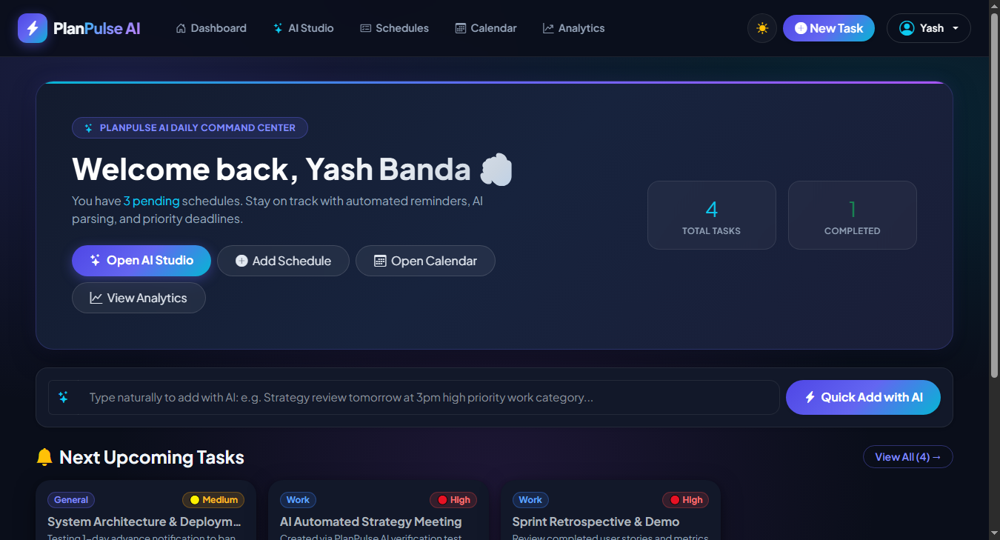
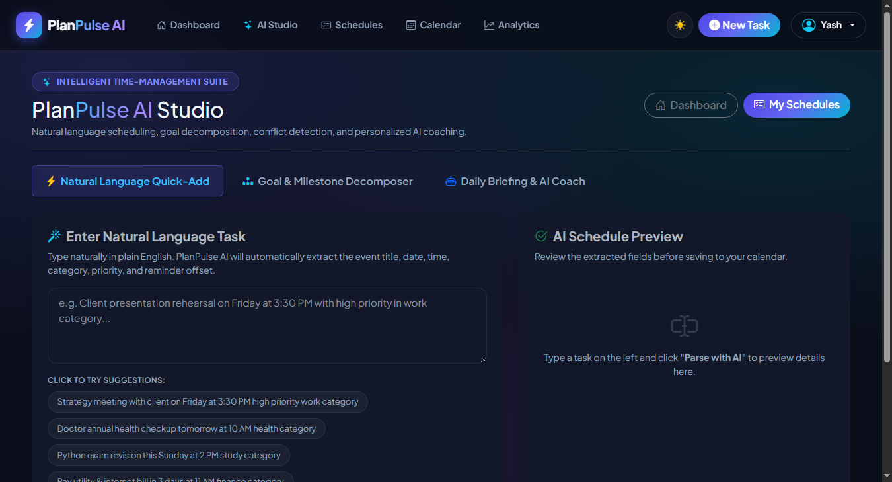
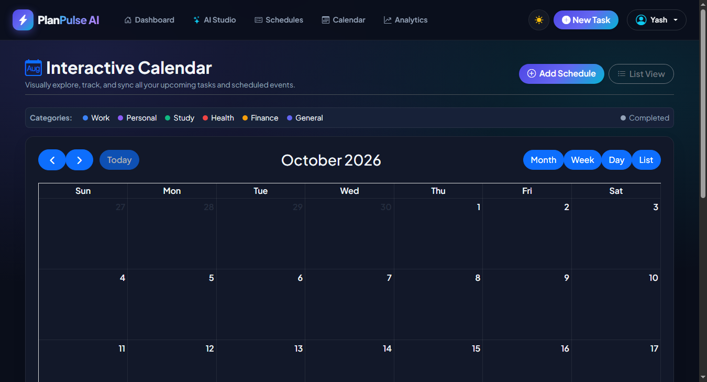
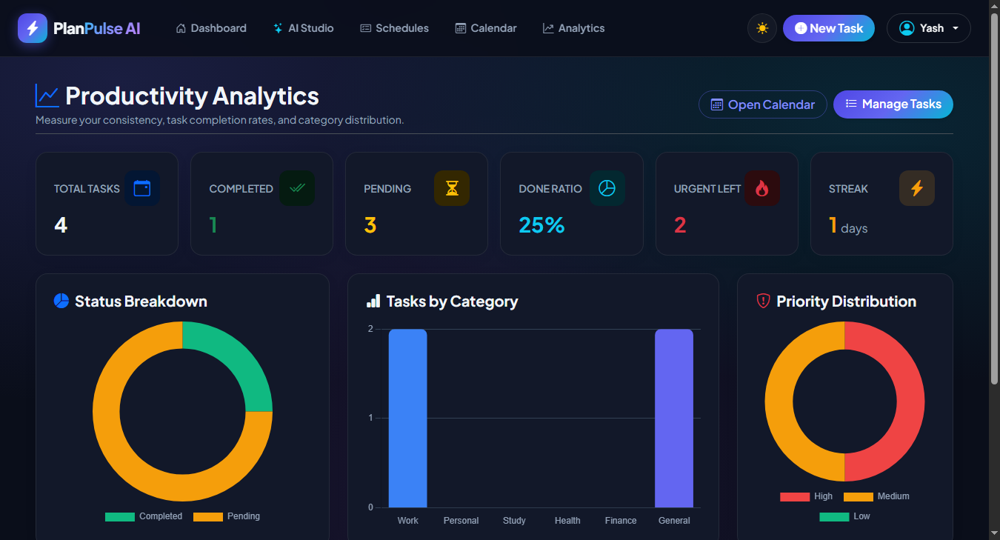
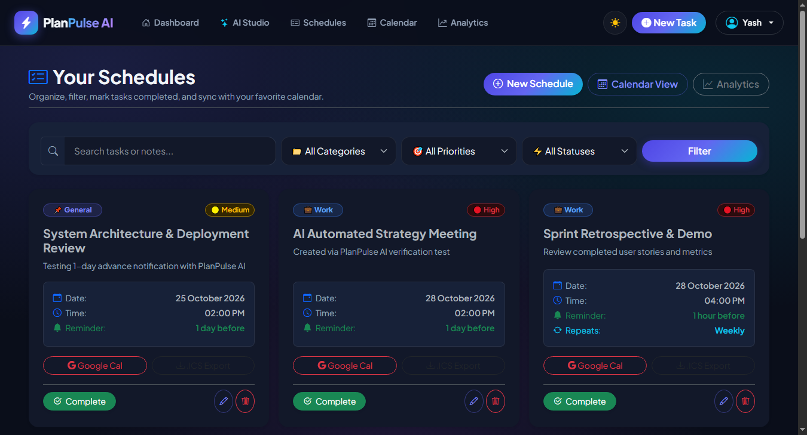
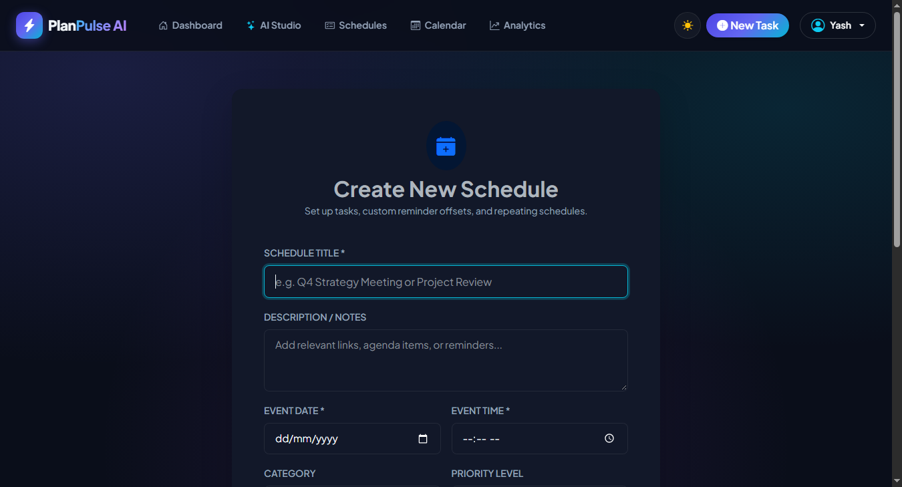
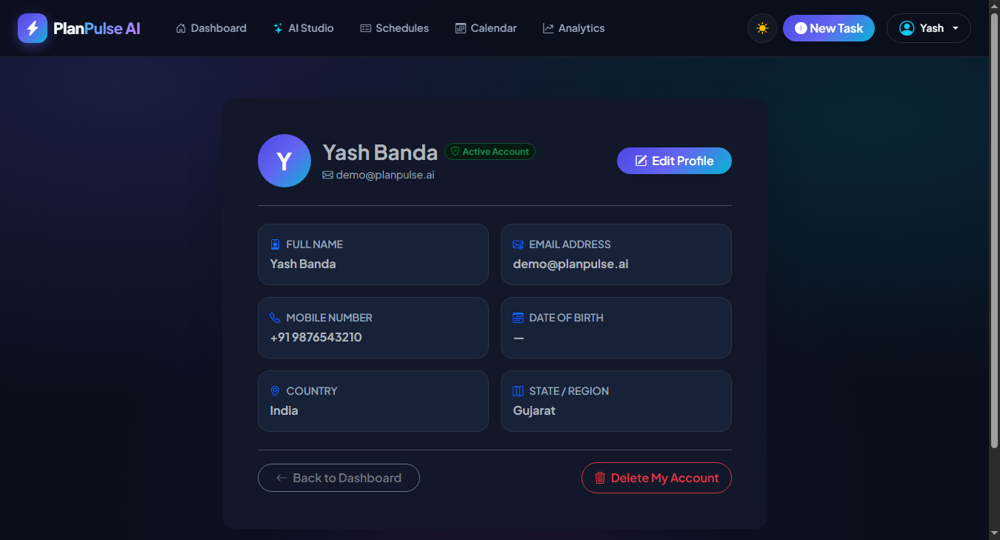
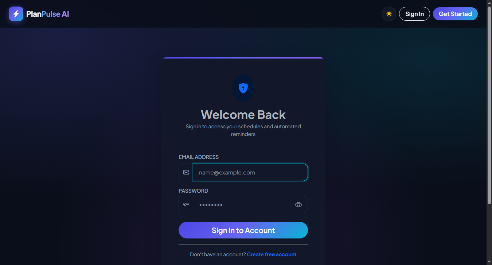
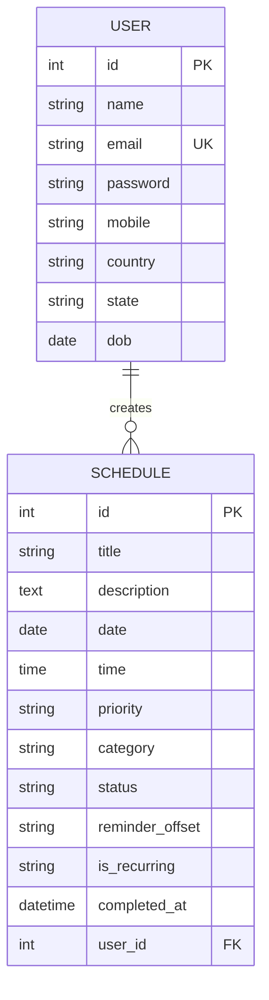

# ⚡ PlanPulse AI — Intelligent Schedule & Productivity Platform

[](https://www.python.org/)
[](https://flask.palletsprojects.com/)
[](https://www.sqlalchemy.org/)
[](https://getbootstrap.com/)
[](https://fullcalendar.io/)
[](https://www.chartjs.org/)
[](https://www.sqlite.org/)
[](https://github.com/Yashbanda18052003/schedule-manager-web-app)
[](LICENSE)

An intelligent time-management and personal productivity platform built with **Python**, **Flask**, **SQLAlchemy**, and **Bootstrap 5.3**. Featuring a Cyber Midnight Slate SaaS aesthetic, natural language schedule creation (**PlanPulse AI Studio**), automated background email reminders with custom offsets via Gmail SMTP, visual **FullCalendar 6** monthly grids, real-time **Chart.js** analytics, schedule conflict detection, and 1-click **Google Calendar** sync.

---

## 📑 Table of Contents
- [✨ Key Highlights](#-key-highlights)
- [📸 User Interface Showcase](#-user-interface-showcase)
- [⚡ Quick Demo Credentials](#-quick-demo-credentials)
- [🤖 PlanPulse AI Intelligence Suite](#-planpulse-ai-intelligence-suite)
  - [1. ⚡ Natural Language Task Quick-Add (NLP Parser)](#1--natural-language-task-quick-add-nlp-parser)
  - [2. 🎯 AI Milestone & Goal Decomposer](#2--ai-milestone--goal-decomposer)
  - [3. ⚠️ Smart Schedule Conflict Scanner](#3-️-smart-schedule-conflict-scanner)
  - [4. 🧠 Executive Daily Briefing & Workload Analyzer](#4--executive-daily-briefing--workload-analyzer)
  - [5. 🤖 Interactive Productivity Coach](#5--interactive-productivity-coach)
- [🚀 Core Platform Features](#-core-platform-features)
  - [📧 Automated Multi-Interval Email Reminders](#-automated-multi-interval-email-reminders)
  - [🎯 Dynamic Priority & Glowing Category Tags](#-dynamic-priority--glowing-category-tags)
  - [📅 Interactive FullCalendar 6 Grid](#-interactive-fullcalendar-6-grid)
  - [📊 Graphical Productivity Analytics (Chart.js)](#-graphical-productivity-analytics-chartjs)
  - [🔍 Search, Filter & 1-Click Complete](#-search-filter--1-click-complete)
  - [🌐 1-Click Google Calendar Sync & Universal `.ics` Export](#-1-click-google-calendar-sync--universal-ics-export)
- [🛠️ Tech Stack](#️-tech-stack)
- [📂 Project Architecture](#-project-architecture)
- [⚙️ Installation & Running Locally](#️-installation--running-locally)
- [📊 Database Schema](#-database-schema)
- [🔌 API Endpoints](#-api-endpoints)
- [👤 Author & Contributions](#-author--contributions)

---

## ✨ Key Highlights

- **🌌 Cyber Midnight Slate Design System:** High-contrast dark theme (`#0a0e1a`) with ambient radial mesh glow, glassmorphic card elevations, glowing neon chips, and client-side dual theme persistence (`localStorage`).
- **⚡ Natural Language Task Scheduling:** Type or dictate plain English phrases (*"Strategy meeting with client on Friday at 3:30 PM with high priority in work category"*) to automatically extract titles, dates, times, categories, and priorities with 1-click scheduling.
- **🎯 AI Milestone Decomposer:** Enter high-level goals (*"Launch AI SaaS Portfolio"*, *"Pass Python Exam"*) to automatically decompose them into 4 sequenced, actionable milestones with realistic intervals.
- **⚠️ Smart Conflict Detection:** Scans for double-booked or tight back-to-back commitments (< 30 minutes apart) and recommends buffer gap resolutions.
- **📧 Multi-Interval Email Reminders:** Background daemon scheduler (`APScheduler`) checks events every 60 seconds and delivers formatted HTML alerts via Gmail SMTP with zero duplicate delivery.
- **📅 FullCalendar 6 Grid & Modal Inspector:** Responsive monthly grid with category color coding, clickable popovers, and quick event adjustments.
- **📊 Real-Time Chart.js Dashboards:** Status breakdown donut, category distribution bars, priority donuts, and active completion streak tracking.
- **🌐 1-Click Google Calendar & `.ics` Export:** Export schedules to Google Calendar, Apple Calendar, Outlook, and Thunderbird in universal format.

---

## 📸 User Interface Showcase

### 🏠 Command Center & 🤖 PlanPulse AI Studio
| 🏠 Command Center Dashboard & Quick NLP Add | 🤖 PlanPulse AI Studio & NLP Task Extractor |
| :---: | :---: |
|  |  |

---

### 📅 Interactive Calendar & 📊 Graphical Productivity Analytics
| 📅 FullCalendar 6 Monthly Schedule Grid | 📊 Chart.js Productivity Analytics & Streaks |
| :---: | :---: |
|  |  |

---

### 🔍 Schedules Backlog & ➕ Add Schedule Studio
| 🔍 Multi-Filter Schedules List & Priority Pills | ➕ Add Schedule Studio (Categories & Priorities) |
| :---: | :---: |
|  |  |

---

### 👤 Profile Management & 🔐 Cyber Authentication
| 👤 User Profile Details & Account Controls | 🔐 Cyber Midnight Sign-In (In-Input Eye Toggle) |
| :---: | :---: |
|  |  |

---

## ⚡ Quick Demo Credentials

A verified demonstration user is available out-of-the-box:

| Role | Email Address | Password | Capabilities |
| :--- | :--- | :--- | :--- |
| **Demo User** | `demo@planpulse.ai` | `yash123` | Full access to AI Studio, schedules backlog, FullCalendar, Chart.js analytics, email reminders, and profile controls |
| **New User** | *(Register via `/signup`)* | *(Your password)* | Instant personal dashboard with automated database migration |

---

## 🤖 PlanPulse AI Intelligence Suite

PlanPulse AI is powered by a high-performance built-in hybrid NLP reasoning engine in `ai_engine.py`. It operates 100% locally and offline without external dependencies, with optional plug-and-play **Google Gemini API** (`GEMINI_API_KEY`) support.

### 1. ⚡ Natural Language Task Quick-Add (NLP Parser)
* Accepts natural sentences and extracts structured scheduling metadata:
  ```text
  Input: "Client presentation rehearsal on Friday at 3:30 PM with high priority in work category reminder 1 day before"
  
  Output:
  ├── Title: "Client presentation rehearsal"
  ├── Date: Next Friday (auto-calculated)
  ├── Time: 15:30 (3:30 PM)
  ├── Priority: High (🔴)
  ├── Category: Work (💼)
  └── Reminder Offset: 1 Day Before
  ```
* Available directly on the **Dashboard** or in the **AI Studio**.

### 2. 🎯 AI Milestone & Goal Decomposer
* Input a high-level project (e.g., *"Launch my portfolio website"*, *"Pass AWS Cloud Certification"*).
* Decomposes the project into **4 sequenced phases**:
  - Phase 1: Architecture & Requirements (Baseline setup)
  - Phase 2: Core Development & Implementation
  - Phase 3: Testing & Quality Assurance
  - Phase 4: Final Polish, Deployment & Release
* Generates recommended dates, times, categories, and priorities with a 1-click **"Add All Milestones to Schedule"** button.

### 3. ⚠️ Smart Schedule Conflict Scanner
* Scans all events on the same calendar day for:
  - **Double Bookings (Exact Overlaps):** Two events scheduled at the identical time slot.
  - **Tight Transition Buffers:** Events scheduled with less than a 30-minute buffer gap.
* Surfaces prominent glowing amber warning banners and suggests clean 60-minute reschedule slots.

### 4. 🧠 Executive Daily Briefing & Workload Analyzer
* Assesses daily cognitive workload:
  - **Energy Level:** Rest & Rejuvenation / Light / Moderate / High Focus / Maximum Capacity
  - **Task Counts:** Total events today, pending obligations, and high-priority commitments.
  - **Context-Aware Recommendations:** Tailored daily advice based on your completion streaks.

### 5. 🤖 Interactive Productivity Coach
* Chat with your AI coach directly from the AI Studio:
  - *"How should I prioritize today?"* ➔ Generates an "Eat the Frog First" sprint strategy.
  - *"How to prevent afternoon burnout?"* ➔ Ultradian rhythm recommendations and eye rest rules.
  - *"Optimal study & memory technique?"* ➔ Active recall and Feynman technique guidance.

---

## 🚀 Core Platform Features

### 📧 Automated Multi-Interval Email Reminders
* Integrated background scheduler (`APScheduler`) triggers notifications at customizable intervals:
  - `10_min`: 10 minutes prior
  - `1_hour`: 1 hour prior
  - `1_day`: 24 hours prior
  - `1_week`: 7 days prior
* Live delivery powered by Gmail SMTP with rich HTML styling and duplicate protection flags.

### 🎯 Dynamic Priority & Glowing Category Tags
* **Priority Levels:** 🔴 High, 🟡 Medium, 🟢 Low.
* **Organized Categories:**
  - 💼 **Work** (Electric Blue)
  - 👤 **Personal** (Cyber Violet)
  - 📚 **Study** (Emerald Green)
  - 🏃 **Health** (Coral Rose)
  - 💰 **Finance** (Amber Gold)
  - 📌 **General** (Indigo)

### 📅 Interactive FullCalendar 6 Grid
* Visual monthly overview powered by FullCalendar 6 and a dedicated JSON endpoint (`/api/schedules`).
* Category color coding on all event pills.
* Event modal inspector displaying title, category, priority, notes, time, and 1-click update/delete triggers.

### 📊 Graphical Productivity Analytics (Chart.js)
* **KPI Metric Cards:** Total Tasks, Completed, Pending, and Completion Rate %.
* **Streak Counter:** Calculates consecutive days with completed tasks.
* **Status Doughnut Chart:** Real-time ratio of completed vs. pending tasks.
* **Category Breakdown Bar Chart:** Visual distribution across Work, Study, Health, and Finance.
* **Priority Doughnut Chart:** Breakdown of High vs. Medium vs. Low priority commitments.

### 🔍 Search, Filter & 1-Click Complete
* Full-text search querying task titles and notes.
* Instant multi-dropdown filtering by Category, Priority, and Status.
* 1-click task completion toggle with strikethrough styling and timestamp tracking.

### 🌐 1-Click Google Calendar Sync & Universal `.ics` Export
* **Google Calendar:** Auto-generates pre-filled calendar creation links with ISO timestamps.
* **iCalendar (.ics):** Standard iCalendar file downloads for native synchronization with Apple Calendar, Microsoft Outlook, and mobile devices.

---

## 🛠️ Tech Stack

| Layer | Technology | Details |
| :--- | :--- | :--- |
| **Backend Framework** | **Python 3.10+ / Flask 3.1** | Lightweight, high-performance web microframework |
| **Database & ORM** | **SQLite & SQLAlchemy 2.0** | Robust relational persistence with automated schema migration |
| **Authentication** | **Flask-Login & Werkzeug** | Secure hashed passwords (`pbkdf2:sha256`) and session management |
| **Background Scheduler**| **Flask-APScheduler** | Daemon interval runner for automated email dispatch |
| **Email Delivery** | **Flask-Mail & Gmail SMTP** | Secure TLS delivery with custom HTML alert templates |
| **AI & NLP Engine** | **PlanPulse AI Engine (`ai_engine.py`)** | Deterministic NLP entity extraction, goal decomposition, and coach reasoning |
| **Frontend Styling** | **Bootstrap 5.3 & Custom CSS** | Cyber Midnight Slate theme, glassmorphic acrylic navbar, radial mesh glow |
| **Calendar Engine** | **FullCalendar 6.1** | Responsive month/week visual grid with JSON event feeds |
| **Data Visualizations** | **Chart.js 4.4** | Interactive doughnut and horizontal bar charts |

---

## 📂 Project Architecture

```text
schedule reminder/
├── app.py                      # Core Flask application, auth, routes & background jobs
├── models.py                   # SQLAlchemy User & Schedule models & schema upgrades
├── ai_engine.py                # PlanPulse AI NLP parser, goal decomposer & coach logic
├── users.db                    # SQLite production database
├── requirements.txt            # Python dependencies
├── Procfile                    # Deployment entry point
├── run_app.bat                 # 1-Click Windows startup launcher
├── .env                        # Environment credentials (SMTP, keys, secrets)
├── .env.example                # Template for environment configuration
│
├── assets/
│   └── screenshots/            # Showcase screenshots for documentation
│       ├── 01_home_dashboard.png
│       ├── 02_ai_command_studio.png
│       ├── 03_interactive_calendar.png
│       ├── 04_productivity_analytics.png
│       ├── 05_schedules_backlog.png
│       ├── 06_auth_login.png
│       ├── 07_signup_screen.png
│       ├── 08_add_schedule.png
│       └── 09_profile_view.png
│
├── static/
│   └── css/
│       └── style.css           # Cyber Midnight Slate SaaS design system & theme tokens
│
└── templates/
    ├── base.html               # Base layout, glassmorphic navbar, theme toggle & footer
    ├── home.html               # Command center dashboard & quick NLP add bar
    ├── ai_studio.html          # PlanPulse AI Studio (NLP parser, goals, coach chat)
    ├── view_schedules.html     # Schedules backlog, search, filters & export actions
    ├── add_schedule.html       # Add schedule form (categories, priorities, offsets)
    ├── edit_schedule.html      # Edit schedule form
    ├── calendar.html           # FullCalendar 6 interactive monthly view
    ├── analytics.html          # Chart.js visual analytics & streak trackers
    ├── login.html              # Cyber Midnight sign-in page
    ├── signup.html             # User registration with password validation
    ├── profile.html            # Profile edit form
    ├── profile_view.html       # Profile details & safe account deletion
    ├── about.html              # About PlanPulse AI & developer bio
    └── contact.html            # Contact channels & social connections
```

---

## ⚙️ Installation & Running Locally

### 1. Clone the Repository
```bash
git clone https://github.com/Yashbanda18052003/schedule-manager-web-app.git
cd schedule-manager-web-app
```

### 2. Set Up Virtual Environment
```bash
# Windows
python -m venv venv
venv\Scripts\activate

# macOS / Linux
python3 -m venv venv
source venv/bin/activate
```

### 3. Install Dependencies
```bash
pip install -r requirements.txt
```

### 4. Configure Environment Variables (`.env`)
Create a `.env` file in the root directory:
```ini
SECRET_KEY=planpulse_ai_production_secret_key_2026
MAIL_SERVER=smtp.gmail.com
MAIL_PORT=587
MAIL_USE_TLS=True
MAIL_USERNAME=your_email@gmail.com
MAIL_PASSWORD=your_gmail_app_password
MAIL_DEFAULT_SENDER=your_email@gmail.com

# Optional: Add Google Gemini API key for external LLM coaching
# GEMINI_API_KEY=your_gemini_api_key_here
```

### 5. Launch the Application

**Option A — Windows 1-Click Launcher:**
Double-click `run_app.bat` in the root directory.

**Option B — Command Line:**
```bash
python app.py
```
Open **`http://127.0.0.1:5000`** in your browser. All tables are automatically verified and migrated upon launch.

---

## 📊 Database Schema



### `users` Table
| Column | Type | Constraints | Description |
| :--- | :--- | :--- | :--- |
| `id` | `INTEGER` | `PRIMARY KEY` | Unique user identifier |
| `name` | `VARCHAR(150)`| `NOT NULL` | Full name of the user |
| `email` | `VARCHAR(150)`| `UNIQUE, NOT NULL` | Registered email for login & reminders |
| `password` | `VARCHAR(150)`| `NOT NULL` | Werkzeug salted security hash |
| `mobile` | `VARCHAR(20)` | `NULLABLE` | Optional phone contact |
| `country` | `VARCHAR(100)`| `NULLABLE` | Country of residence |
| `state` | `VARCHAR(100)`| `NULLABLE` | State or region |
| `dob` | `DATE` | `NULLABLE` | Date of birth |

### `schedule` Table
| Column | Type | Constraints | Description |
| :--- | :--- | :--- | :--- |
| `id` | `INTEGER` | `PRIMARY KEY` | Unique task identifier |
| `title` | `VARCHAR(100)`| `NOT NULL` | Title of the commitment |
| `description` | `TEXT` | `NULLABLE` | Detailed notes or meeting link |
| `date` | `DATE` | `NOT NULL` | Scheduled calendar date |
| `time` | `TIME` | `NOT NULL` | Scheduled time |
| `priority` | `VARCHAR(20)` | `DEFAULT 'medium'` | `high`, `medium`, or `low` |
| `category` | `VARCHAR(50)` | `DEFAULT 'general'` | `work`, `personal`, `study`, `health`, `finance`, `general` |
| `status` | `VARCHAR(20)` | `DEFAULT 'pending'` | `pending` or `completed` |
| `reminder_offset`| `VARCHAR(20)`| `DEFAULT '1_day'` | `10_min`, `1_hour`, `1_day`, or `1_week` |
| `is_recurring` | `VARCHAR(20)` | `DEFAULT 'none'` | `none`, `daily`, `weekly`, `monthly` |
| `completed_at` | `DATETIME` | `NULLABLE` | Timestamp when marked completed |
| `user_id` | `INTEGER` | `FOREIGN KEY` | Reference to `users.id` |

---

## 🔌 API Endpoints

| Method | Endpoint | Access | Description |
| :--- | :--- | :--- | :--- |
| `GET` | `/` | Public / Auth | Landing hero or Command Center Dashboard |
| `POST`| `/signup` | Public | Register new user account |
| `POST`| `/login` | Public | Authenticate user credentials |
| `GET` | `/logout` | Authenticated | Terminate active user session |
| `GET` | `/schedules` | Authenticated | View schedules with search & filters |
| `POST`| `/add_schedule` | Authenticated | Create a new schedule manually |
| `POST`| `/update_schedule/<id>` | Authenticated | Edit existing task details |
| `POST`| `/delete_schedule/<id>` | Authenticated | Remove schedule from database |
| `POST`| `/toggle_schedule_status/<id>`| Authenticated | 1-click toggle between pending/completed |
| `GET` | `/schedules/<id>/export_ics`| Authenticated | Download universal `.ics` calendar file |
| `GET` | `/calendar` | Authenticated | Interactive FullCalendar monthly grid |
| `GET` | `/api/schedules` | Authenticated | JSON event feed for FullCalendar |
| `GET` | `/analytics` | Authenticated | Real-time Chart.js productivity dashboard |
| `GET` | `/ai/studio` | Authenticated | PlanPulse AI Command Studio |
| `POST`| `/api/ai/parse-task` | Authenticated | Parse natural language sentence into task JSON |
| `POST`| `/api/ai/save-task` | Authenticated | Save parsed AI task directly to schedule |
| `POST`| `/api/ai/breakdown-goal`| Authenticated | Decompose goal into 4 scheduled milestones |
| `POST`| `/api/ai/save-milestones` | Authenticated | Batch save generated milestones |
| `POST`| `/api/ai/coach-chat` | Authenticated | Ask AI Productivity Coach for advice |
| `GET` | `/profile/view` | Authenticated | View profile details & account controls |
| `POST`| `/delete_user/<id>` | Authenticated | Permanently delete user account |

---

## 👤 Author & Contributions

* **Author:** **Banda Yash**
* **GitHub:** [@Yashbanda18052003](https://github.com/Yashbanda18052003)
* **LinkedIn:** [Banda Yash](https://www.linkedin.com/in/banda-yash-829633259/)
* **Project Repository:** [schedule-manager-web-app](https://github.com/Yashbanda18052003/schedule-manager-web-app)

*Contributions, issues, and feature requests are welcome! If you find this project helpful, please give it a ⭐️ on GitHub.*
